# Email Triage con Groq

  

Workflow de n8n que clasifica el correo entrante con un LLM y decide qué hacer con cada mensaje, para dejar de perder la mañana decidiendo qué leer primero.

## Problema

Inbox con no leídos sin priorizar. Leer uno por uno roba horas y no distingue lo urgente de lo informativo.

## Objetivo

Clasificar cada email en **Action / Receipt / Informational / Spam** con Groq, etiquetar en Gmail, preparar el borrador de los importantes y registrar todo en una hoja de cálculo. Las notificaciones (Slack/Telegram) solo para lo urgente.

## Arquitectura

<p align="center">
  
</p>

*Fuente editable en [`docs/diagrama-flujo.mmd`](docs/diagrama-flujo.mmd). Se publica como imagen porque el renderizador de Mermaid de GitHub fallaba con este grafo.*

## Estado

| Etapa | Estado |
| :-- | :-- |
| Clasificación con Groq (`response_format: json`) | ✅ implementado |
| Parseo con fallback a `Informational` | ✅ implementado |
| Router de 4 categorías | ✅ implementado |
| Etiquetado y borrador en Gmail | ⏳ v2 |
| Registro en Google Sheets | ⏳ v2 |
| Aviso urgente por Slack/Telegram | ⏳ v2 |

El flujo actual es *fixture-first*: los disparadores son de prueba y la clasificación se valida contra emails de ejemplo antes de conectar el buzón real.

## Métrica

- 3 casos de prueba clasificados correctamente en ~2 s.
- Fallback seguro: respuesta vacía o irreconocible → `Informational`, sin romper el flujo.
- 0 secretos en el repositorio: la key va por variable de entorno.

La evidencia de las pruebas está en [`docs/evidencia.md`](docs/evidencia.md).

## Estructura

```
.
├── n8n/workflow.json          workflow importable
├── docs/diagrama-flujo.svg    diagrama del flujo (imagen)
├── docs/diagrama-flujo.mmd    fuente Mermaid del diagrama
├── docs/evidencia.md          criterios de aceptación y resultados
├── docs/post-linkedin.md      borrador del post que describe el proyecto
└── .env.example               variables necesarias (sin valores)
```

## Puesta en marcha

1. Copia `.env.example` a `.env` y completa `GROQ_API_KEY`.
2. Importa `n8n/workflow.json` en n8n (timezone `America/Santiago`, `active=false`).
3. Ejecuta el disparador manual: clasifica los emails de ejemplo.
4. Para el modo real, conecta Gmail OAuth, Google Sheets y el canal de avisos (Telegram o Slack).

## Seguridad

- `GROQ_API_KEY` solo vía `{{$env.GROQ_API_KEY}}`; nunca en el JSON del workflow.
- Las etiquetas de Gmail se crean a mano: Action, Receipt, Informational.
- Sin PII real en la evidencia; los ejemplos usan `example.com`.

## Roadmap

- Fallback a Ollama local (coste cero).
- Matriz de Eisenhower de 4 cuadrantes.
- Notificación en Slack con botones aprobar/rechazar (human-in-the-loop).

## Licencia

MIT — ver [`LICENSE`](LICENSE).
